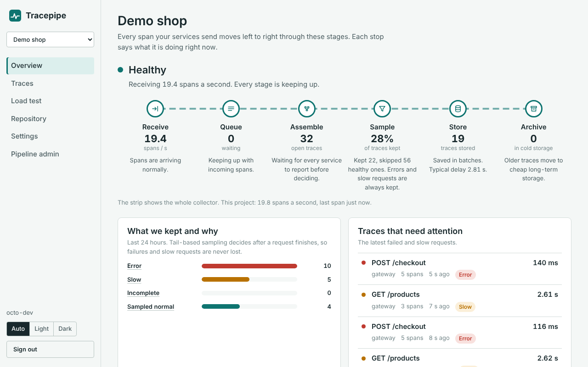
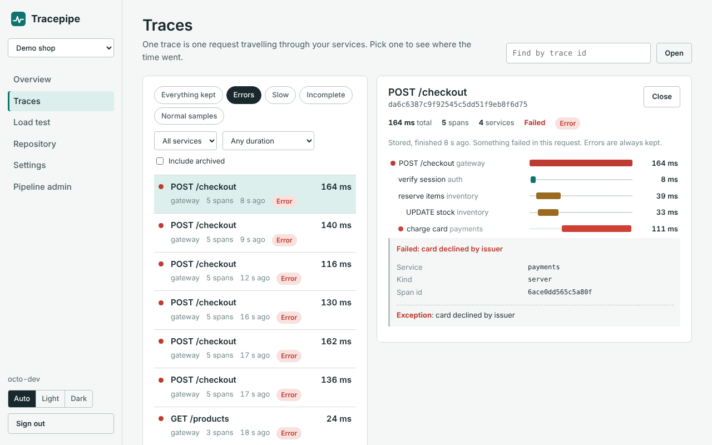
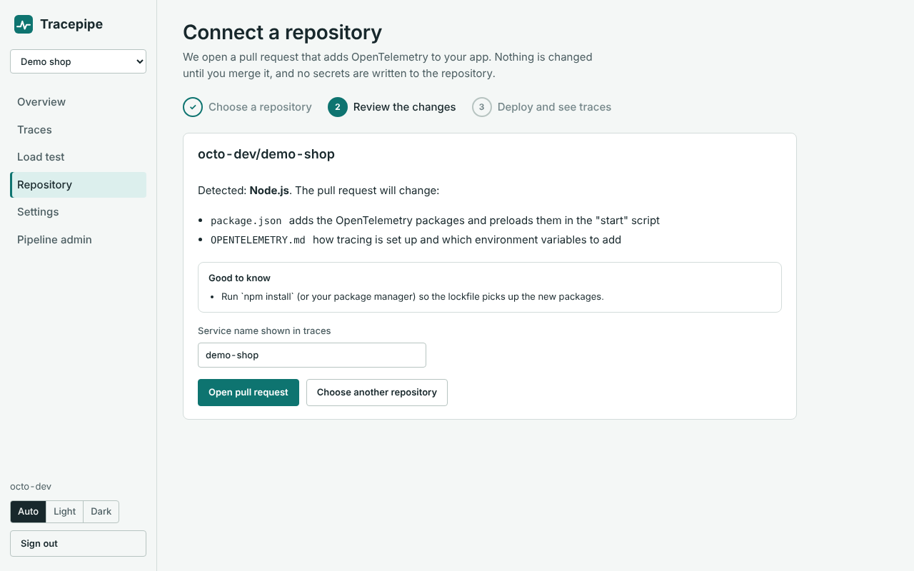
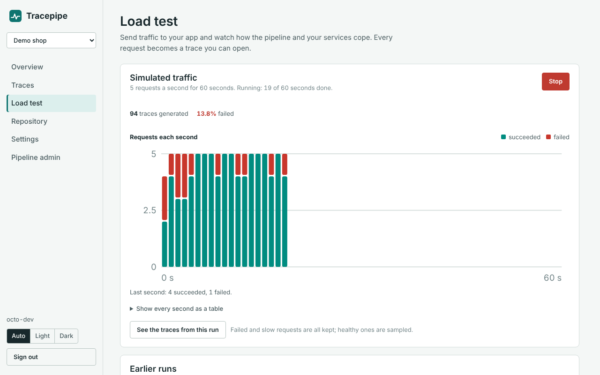
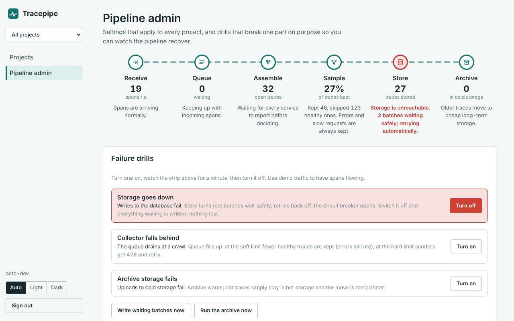

# Tracepipe: an OpenTelemetry trace pipeline you can see working

A Group 21 system design project.

Sign in with GitHub, connect a repository, and Tracepipe opens a pull request that adds
OpenTelemetry to your app. Once it is deployed, every request becomes a trace: the collector
assembles spans from all your services, keeps **every failed and slow request** (tail-based
sampling), stores the rest as a sample, and archives old traces to cheap object storage.
Load-test your app from the dashboard and watch the pipeline cope, or break a part of it on
purpose and watch it recover.



| One request across four services, with the exception | Connect a repository |
|---|---|
|  |  |
| **Load test or simulated traffic** | **Failure drill: storage down, nothing lost** |
|  |  |

## How it works



```
OTLP (protobuf/JSON) ─► ingest: key check, rate limit ─► bounded queue (backpressure, 429)
  ─► aggregator: group by trace, dedup, timeout, late-span merge
  ─► tail sampler: ERROR and slow always kept, healthy traces sampled per project
  ─► batch writer: ordered, retried, circuit breaker, shed + spill under long outages
  ─► hot store (Postgres) ─► archive worker ─► cold store (Cloudflare R2)
```

More detail: the [architecture](docs/architecture.md), the [decision records](docs/adr), how each
[failure scenario](docs/failure-drills.md) is handled, and the [deployment runbook](docs/deployment.md).

## Run it locally in 90 seconds

Needs Node.js 22.13 or newer. No database to install: local runs use the built-in SQLite.

```bash
npm install
npm start                 # collector on http://localhost:4318
npm run dev:web           # dashboard on http://localhost:5173 (second terminal)
```

Open http://localhost:5173, use **Development sign-in** with any name, create a project, then
**Load test → Start simulated traffic**. The overview comes alive within a few seconds.

To see a real OpenTelemetry app instead, run the demo shop with the project's ingest key:

```bash
cd examples/demo-shop && npm install
OTEL_EXPORTER_OTLP_ENDPOINT=http://localhost:4318 OTEL_EXPORTER_OTLP_HEADERS=x-api-key=otk_... npm start
npm run traffic -- http://localhost:3000 3 60      # another terminal
```

Each checkout is one trace across `demo-gateway`, `demo-orders` and `demo-payments`.

## Repository

```
apps/collector     Node 22 + Express 5: ingest, pipeline, storage, auth, GitHub App, load tests
apps/web           React + Vite dashboard
examples/demo-shop three services with OpenTelemetry zero-code instrumentation
tools/loadgen      CLI traffic generator and exact end-to-end reconciliation
e2e                browser tests (Playwright)
docs               architecture, ADRs, failure drills, deployment runbook, diagrams
```

## Commands

| Command | What it does |
|---|---|
| `npm start` | collector (port 4318) |
| `npm run dev:web` / `npm run build:web` | dashboard dev server / production build |
| `npm test` | collector test suite (SQLite; set `TEST_DATABASE_URL` to run it on Postgres) |
| `npm run e2e` | browser end-to-end tests (needs `npm run build:web` first) |
| `npm run loadgen -- --key otk_...` | CLI traffic into a project |
| `npm run reconcile -- --duration 60 --wait 40 --storage-outage` | exact end-to-end count check |
| `npm run secrets` | fresh `JWT_PRIVATE_KEY` and `ADMIN_TOKEN` for deployment |
| `npm run reset` | delete local data |

## Deploy

Free tiers: collector on Render, dashboard on Vercel, Postgres on Neon, archive on Cloudflare
R2, sign-in and pull requests through a GitHub App. Step-by-step: [docs/deployment.md](docs/deployment.md).

## API

| Method | Path | Who | Purpose |
|---|---|---|---|
| POST | `/v1/traces` | apps (`x-api-key`) | OTLP/HTTP protobuf or JSON (also the legacy flat JSON) |
| GET | `/.well-known/jwks.json` | anyone | public keys for the dashboard's access tokens |
| * | `/api/auth/*` | browser | GitHub sign-in, session refresh, sign out |
| * | `/api/projects/*` | signed-in user | projects, keys, traces, stats, repository, load tests |
| * | `/api/admin/*`, `/v1/config`, `/v1/faults` | admin / `X-Admin-Token` | pipeline settings and failure drills |
| GET | `/metrics` (`?format=prometheus`) | `X-Admin-Token` | pipeline and collector metrics |
| GET | `/health`, `/livez` | anyone | readiness detail, liveness |

## Contributing

Branching (`dev`, `feat/*` merged with `--no-ff`), Conventional Commits and phase gates:
[CONTRIBUTING.md](CONTRIBUTING.md).
