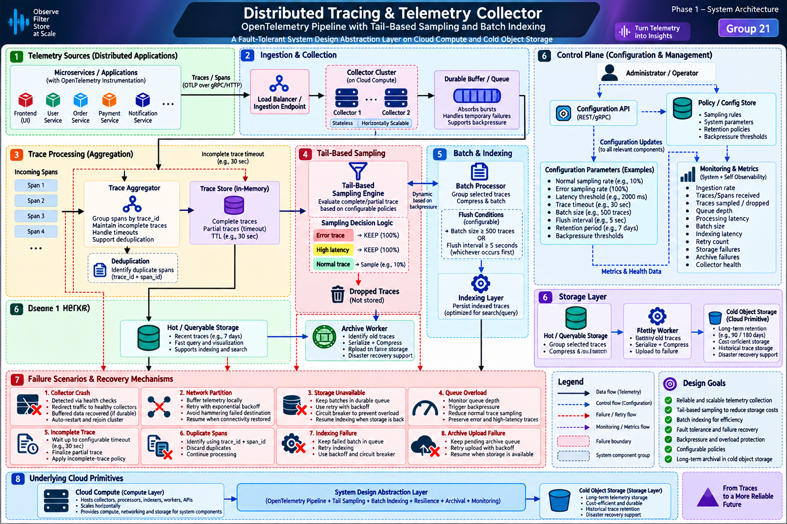

# Architecture



> The diagram is the Phase 1 design reference. Known diagram errata to fix in Phase 7:
> two sections are numbered "6", and some labels are garbled ("Dseone 1 HERKR" → Hot storage,
> "Rletiy Worker" → Archive worker).

## Product in one paragraph

A developer signs in with GitHub, picks a repository, and our GitHub App opens a pull request
that adds OpenTelemetry auto-instrumentation plus three environment variables. After merging and
deploying (anywhere), the app exports OTLP traces to our collector using a per-project ingest key.
The developer can then load-test their deployed URL from our UI and watch, in plain language, how
traces move through the pipeline and which ones the tail sampler kept and why.

## Pipeline (what exists today, `apps/collector`)

```
POST /v1/traces → validate → SpanQueue (bounded; soft/hard limits, 429 + Retry-After)
  → Aggregator (group by trace_id, dedup by trace_id+span_id, timeout, tombstones)
  → Sampler (tail-based: ERROR 100%, HIGH_LATENCY 100%, INCOMPLETE kept, NORMAL ~10%;
             normal rate × backpressure factor when the queue is not NORMAL)
  → BatchProcessor (size/interval flush, in-order single writer, backoff, circuit breaker,
                    shed NORMAL first then spill to disk under long outages)
  → TraceRepo (SQLite WAL, merge-on-write, cursor-paged search)
  → ArchiveWorker (gzip day-folders, write-then-index-then-delete, cold retention purge)
Control plane: RuntimeConfig (validated, versioned, hot-reload), faults, /metrics, /health.
```

## Known gaps and the phase that closes each

| # | Gap | Phase |
|---|---|---|
| G1 | `/v1/traces` accepts our own flat JSON, not OTLP (real SDKs get 400s) | 1 |
| G2 | Completeness relies on a custom `trace.expected_spans` hint; without it real traces are finalized after 500 ms and later services' spans are dropped as "late" | 1 |
| G3 | No users, projects or tenant isolation | 2 |
| G4 | Control endpoints are open when `ADMIN_TOKEN` is unset | 2 |
| G5 | SQLite, spill and `cold/` live on local disk; Render Free disk is ephemeral | 5 |
| G6 | Collector is long-running and stateful, so it cannot run on Vercel | 5 (Render) |
| G7 | Aggregator state is in-memory, so only one instance is correct | documented; trace-id routing after v1.0 |
| G8 | Archived-trace search filters by root service only; cold reads use `gunzipSync` | 6 |

## Deployment target (v1.0)

```
Browser ──► Vercel (apps/web, React+Vite) ──/api/* rewrite──► Render Free (apps/collector)
User apps ──OTLP/HTTP + ingest key──────────────────────────► Render Free (apps/collector)
apps/collector ──► Neon Postgres (users, projects, keys, hot traces)
               ──► Cloudflare R2 (cold archive, spill)
               ──► GitHub (OAuth sign-in, GitHub App PRs)
```

See `docs/adr/` for the reasoning behind each choice.

## Phase roadmap

| Phase | Goal | Gate demo |
|---|---|---|
| 0 | Monorepo, CI, docs | Repo on GitHub, CI green |
| 1 | OTLP ingest, late-span fix, demo-shop, React trace list + waterfall | Real OTel spans → one complete waterfall |
| 2 | GitHub sign-in, JWT/JWKS, projects, ingest keys, tenant isolation | Two users see only their own traces |
| 3 | Connect repo: stack detection, snippet, GitHub App PR, first-trace check | Merge PR → wizard turns green |
| 4 | Verified load testing + demo traffic | 60 s test → live charts + kept traces |
| 5 | Postgres, R2, Render + Vercel deploy | Full flow on public URLs |
| 6 | Rate limits, retention, async cold reads, self-metrics, Playwright, failure drills | All 8 drills pass in cloud |
| 7 | Plain-language UI, corrected diagram, docs | Tag v1.0.0 |
